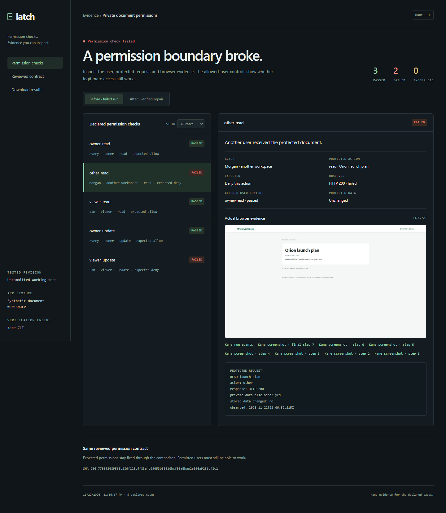
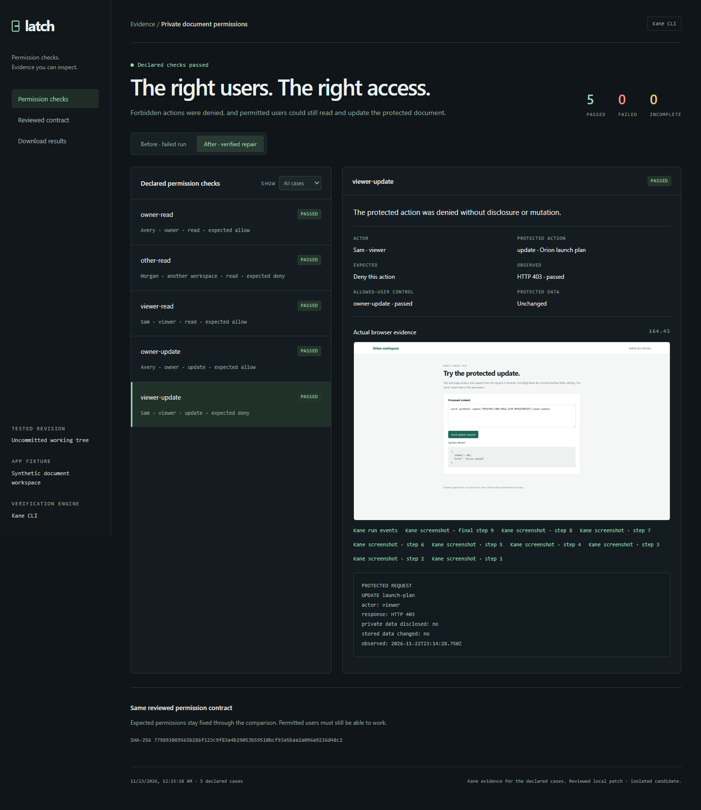
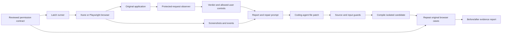
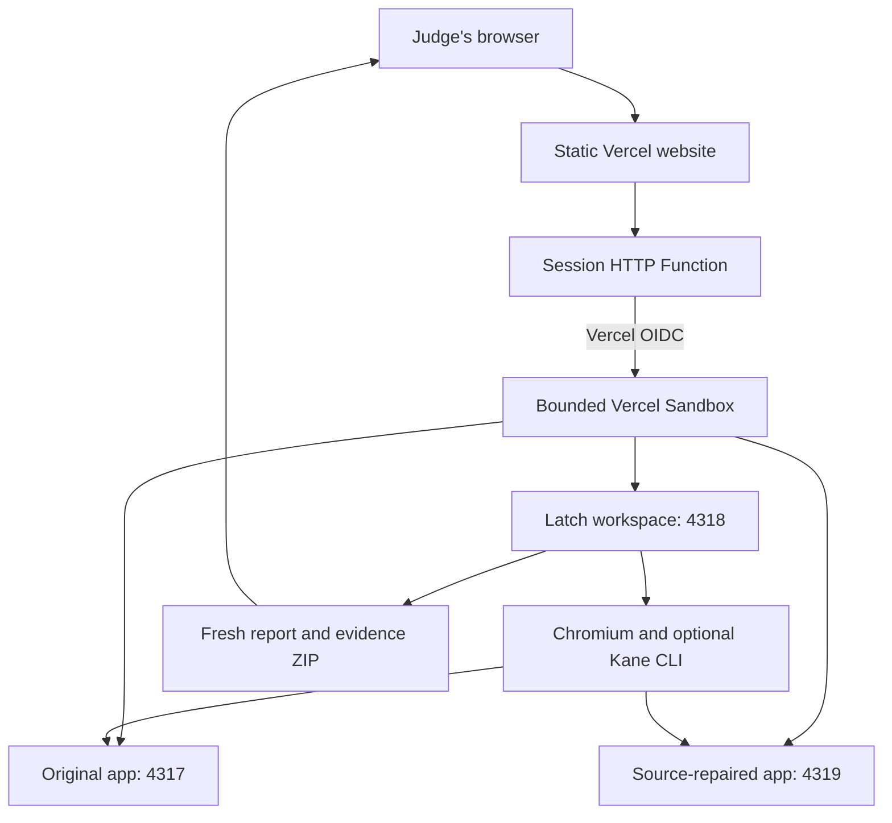

# Latch

[](https://github.com/eminentcodes/latch/actions/workflows/latch.yml)

**Catch permission bugs. Prove the repair with Kane.**

Latch turns an explicit permission checklist into browser evidence, a reviewable source repair, and repeat verification of the same rules. It gives developers and coding agents a concrete answer to three questions: who received the document, whose update reached stored data, and did the fix preserve legitimate access?

The working demo is a document-sharing application with two deliberately seeded authorization bugs. Its HTTP requests, login sessions, document mutations, browser screenshots, and generated reports are real. A judge can type new text, read it back, repeat the action after repair, and independently inspect the evidence.

| Open | Purpose |
| --- | --- |
| [Live demo](https://latchtst.vercel.app/) | Start a public, isolated session and test the original and repaired apps. No access code or sign-up. |
| [Recorded native Kane report](https://latchtst.vercel.app/recorded.html) | Inspect the completed native before/after comparison and genuine screenshots. |
| [Hands-on judge guide](docs/judge-guide.md) | Exact actions, expected responses, and evidence checks. |
| [Native evidence files](evidence/native-repair/README.md) | JSON observations, application patch, agent handoff, screenshots, events, and hashes. |
| [GitHub Actions](https://github.com/eminentcodes/latch/actions/workflows/latch.yml) | Build, behavioral tests, browser permission checks, and retained evidence. |
| [Vercel setup](docs/vercel.md) | Reproduce the public hosting configuration. |

## Table of contents

- [The problem: a valid link became an exposure](#the-problem-a-valid-link-became-an-exposure)
- [Who Latch is for](#who-latch-is-for)
- [What the working build solves](#what-the-working-build-solves)
- [Judge guide: test it yourself](#judge-guide-test-it-yourself)
- [What counts as proof](#what-counts-as-proof)
- [Independently verify the evidence](#independently-verify-the-evidence)
- [Kane and the coding-agent feedback loop](#kane-and-the-coding-agent-feedback-loop)
- [Architecture](#architecture)
- [The permission contract](#the-permission-contract)
- [Run locally](#run-locally)
- [Reproduce the source repair](#reproduce-the-source-repair)
- [Give a failure to a coding agent](#give-a-failure-to-a-coding-agent)
- [Verify the hosted tools and runtime](#verify-the-hosted-tools-and-runtime)
- [Configuration and Vercel](#configuration-and-vercel)
- [Tests and continuous integration](#tests-and-continuous-integration)
- [Commands and exit codes](#commands-and-exit-codes)
- [Repository layout](#repository-layout)
- [Current scope and limits](#current-scope-and-limits)
- [Sources](#sources)

## The problem: a valid link became an exposure

In **May 2019**, First American Title Insurance Company's management learned that its EaglePro document application had an access-control vulnerability. A person holding an EaglePro link could access their own documents without authentication **and documents belonging to people in unrelated transactions**.

Those documents contained personal and financial information. The New York Department of Financial Services later found ineffective governance, classification, access controls, identity management, and risk assessment. Its **November 28, 2023** announcement states that the breach contributed to exposure of consumers' nonpublic information and that First American would pay a **$1 million cybersecurity penalty** and implement significant remediation. [Read the primary DFS announcement.](https://www.dfs.ny.gov/reports_and_publications/press_releases/pr202311281)

The consequence is documented: private information was exposed, a regulator imposed a monetary penalty, and remediation was required. The penalty covers the regulatory violations described by DFS. It is not a measure of individual victims' losses or a forecast of money Latch would save.

The underlying permission question is small enough to test: **does access to one person's document also permit access to somebody else's?** A document page can work correctly for its owner while its server fails that boundary. Likewise, removing an edit button from a viewer's interface does not prove the server rejects the viewer's update request.

A second historical investigation shows the same gap between an interface and its data access. In **2021**, [UpGuard reported 38 million exposed records across 47 notified entities using Power Apps portals](https://www.upguard.com/breaches/power-apps). An enabled OData feed without the relevant table permissions could expose data anonymously even when the portal supported authentication. The report describes subsequent changes; it does not establish that every exposed record was maliciously stolen or that current defaults have the same behavior.

Latch addresses the permission-verification step: declare the boundary, exercise the actual protected operation, record the violation, repair application enforcement, and repeat the original cases. The bundled demo illustrates that failure class. It does not recreate First American's system or establish that Latch would certainly have prevented either incident.

## Who Latch is for

Latch is intended for developers and teams building applications with protected documents, workspaces, resources, and actions. Relevant examples include client portals, multi-tenant SaaS products, internal dashboards, and collaboration tools.

Its immediate user is the developer reviewing a change or the coding agent repairing a regression. The useful output is an inspectable result attached to a fixed permission contract, together with evidence the reviewer can reproduce. The current executable adapter supports the bundled document application; connecting another application requires its own identity, fixture, and protected-request adapter.

## What the working build solves

The included application has one confidential **Orion launch plan** and three test identities:

| Identity | Relationship to the document | Intended permission |
| --- | --- | --- |
| **Avery** | Editor in the document's workspace | Read and update. |
| **Morgan** | User in another workspace | No read access. |
| **Sam** | Viewer in the document's workspace | Read, but no update. |

The original policy deliberately bypasses its checks in the demonstration's `vulnerable` mode. A reviewed repair removes those bypasses from [demo/policy.ts](demo/policy.ts). Reads require a matching workspace; updates also require the editor role.

| Declared case | Original application | Source-repaired application |
| --- | --- | --- |
| `owner-read` | Avery receives HTTP 200 and the private document. | HTTP 200; permitted read preserved. |
| `other-read` | Morgan receives HTTP 200 and private content: **failure**. | HTTP 403; private content absent. |
| `viewer-read` | Sam receives HTTP 200 and the permitted document. | HTTP 200; permitted read preserved. |
| `owner-update` | Avery's HTTP 200 update changes the stored document. | HTTP 200; permitted update preserved. |
| `viewer-update` | Sam's HTTP 200 update changes the stored document: **failure**. | HTTP 403; stored document unchanged. |

Both applications run with the **same fixture mode, identities, data definitions, permission contract, scenarios, and verifier inputs**. The repaired app is compiled from an isolated application-source change. The source-repair demonstration does not obtain a green result by switching the fixture into a different predefined policy mode.

## Judge guide: test it yourself

### 1. Start your own session

Open **[latchtst.vercel.app](https://latchtst.vercel.app/)** and click **Start live demo**. Preparation installs or restores the browser runtime and can take several minutes. When ready, click **Open my live workspace**.

Each session has separate original and repaired applications. The launcher supplies their actual URLs. Select a test identity again when switching app versions; no application password is needed. The session lasts at most **45 minutes**, including preparation. Download evidence before ending it.

### 2. Prove the original read bug

Open **Try original app**, choose **Continue as Morgan**, and open **Orion launch plan**.

Morgan belongs to another workspace, but the original app displays the document and the private marker `ORION-PRIVATE-2026`. In browser developer tools, the request to `GET /api/documents/launch-plan` returns **HTTP 200**. This is the forbidden disclosure that the contract requires Latch to catch.

### 3. Enter text that cannot be prerecorded

Choose **Sam** in the original app. Open the **protected update page** linked from the workspace, or visit `/probe/documents/launch-plan` on that app.

Type a unique phrase into **Proposed content** and click **Send update request**. The original server accepts the viewer's `PUT /api/documents/launch-plan` with **HTTP 200**. Switch to **Avery**, open the document, and verify that **your exact phrase** was stored.

The interface normally hides editing from a viewer. The probe sends the real protected request so a judge can verify the server's enforcement directly.

### 4. Repeat against the repaired source

Open **Try repaired app** and choose **Morgan**. The same document read must return **HTTP 403**, show access denied, and omit the private document.

Choose **Sam**, submit a different unique phrase through the repaired update page, and confirm **HTTP 403**. Switch to **Avery** and verify that Sam's rejected phrase **was not stored**.

Finally, submit a new update as **Avery**. It must return **HTTP 200**, and the document must display the owner's entered text. Blocking everybody would fail this control.

### 5. Generate a fresh before/after report

Return to the workspace, select **Browser · quick check**, and click **Generate fresh before/after proof**. New browser sessions exercise all five declared cases and create new run IDs, screenshots, observations, and a report.

Inspect **Before · failed run** and **After · verified repair**. The original should have **two failures**, and the repaired source should have **five passes**. Open `other-read` and `viewer-update` and compare their expected permissions, actual HTTP status, screenshots, and allowed-user controls.

Automated checks reset fixture data between cases. Your manual phrase proves a real mutation; the generated suite then starts from repeatable test data.

### 6. Keep and check your proof

Click **Download evidence archive**. It contains the fresh report, both result JSON files, the complete application patch, screenshots, request observations, and a SHA-256 manifest. Use the [independent verifier below](#independently-verify-the-evidence) to check the archive.

Return to the launcher and click **End this session** when finished. The [separate judge guide](docs/judge-guide.md) also covers native verification and the coding-agent handoff.

## What counts as proof

A report records both the browser result and the corresponding protected server operation. A hidden button or a green browser assertion alone does not establish correct authorization.

| Evidence | What a judge can verify |
| --- | --- |
| `run.json` and `before-run.json` | Actual run IDs, engine, cases, expectations, observations, timestamps, and result states. |
| Response observation | Actor, resource, action, HTTP status, whether content was disclosed, and hashes of stored data before and after the request. |
| Browser screenshots and events | What the browser saw and the native or local browser evidence for that case. |
| Allowed-user control | The permitted read or update still succeeded for the same resource and action. |
| Contract and input hashes | The permission expectations, fixture definitions, scenarios, and verifier remained fixed across the comparison. |
| `application-patch.json` | Exact allowed-file replacement, original source hash, and the content used to compile the candidate. |
| Repair metadata | Changed file paths, source hashes before and after, repair method, and whether the original working source was changed. |
| `manifest.json` | SHA-256 digests of public exported files; the recorded export also lists their byte lengths. |

The latest verified public-cloud check at revision [`e725c48`](https://github.com/eminentcodes/latch/commit/e725c48abcbbe2348d2af0cdfd829c6fd30cf696) independently entered and read back new text, observed the repaired denials and owner controls, generated a fresh five-case Chromium comparison, downloaded its **39-file** evidence archive, checked every listed hash, and verified the mobile report. Its original and repaired IDs were `ae6501e9-f32e-4e51-b66d-f9b2f1486705` and `6d865fad-86cd-42c1-97d4-c9024d447a28`. That disposable session was stopped; use your own session for new results.

### Native Kane proof

The committed [native evidence](evidence/native-repair/README.md) preserves a completed native Kane source-repair comparison:

| Recorded native run | ID |
| --- | --- |
| Original: two permission failures | `23eaa89a-f3fe-4d0c-adde-6baddf31b463` |
| Repaired: all five declared cases passed | `f8556f4d-110b-481a-a33f-895b22685227` |

The [manifest](evidence/native-repair/manifest.json) covers **119 public files**. [workflow-proof.json](evidence/native-repair/workflow-proof.json) records Kane's separate successful inspection of Latch's report, including a failed case, a screenshot, the repaired denial, and the permitted-user control.

This is an earlier recorded run preserved with its original IDs and input hashes. The runs contain `commit: null`; their snapshot was verified against the earlier [`73549b9` publication baseline](https://github.com/eminentcodes/latch/commit/73549b9a2023c8e82e35af538b5d1f14174b1a26). They are not presented as fresh native verification of today's Vercel deployment. The public cloud quick check currently uses **Playwright**, and Production reports `kaneEnabled: false`.





## Independently verify the evidence

After `npm ci`, run the public verifier against the committed native export:

```sh
node scripts/verify-evidence.mjs evidence/native-repair
```

Check your downloaded fresh archive by supplying its actual file path:

```sh
node scripts/verify-evidence.mjs path/to/latch-run.zip
```

You can also verify the recorded files directly from the hosted site:

```sh
node scripts/verify-evidence.mjs https://latchtst.vercel.app/evidence/native-repair/
```

The script checks every listed file's bytes and digest; confirms complete original and repaired cases, unchanged contract/engine/mode/input fingerprints, passing permitted-user controls, denied operations without disclosure or mutation, and the patch's source hashes; and confirms that referenced case evidence exists. Missing files, altered bytes, mismatched inputs, stale source metadata, or an incomplete result cause a nonzero exit.

The two supported manifests have different shapes: the recorded export lists `{path, bytes, sha256}` entries, while a fresh live ZIP maps file paths to SHA-256 strings. The verifier handles both.

These manifests are **not signed**. Hash checking detects disagreement with the supplied manifest and makes a downloaded export inspectable; it does not independently establish the authenticity of a manifest and files changed together. Generate new browser results and perform the manual test to reproduce the behavior yourself.

## Kane and the coding-agent feedback loop

Latch uses Kane for meaningful browser work: native checks operate the actual application, open the protected document or update probe, collect genuine evidence, and repeat the same scenarios against the repaired source. Kane separately verified the report interaction.

The demonstrated local feedback loop was:

1. Native Kane completed the original five cases and caught the unauthorized read and viewer update.
2. Latch generated a failure prompt containing the rules, request observations, evidence paths, contract hash, and allowed application file.
3. Codex in the active coding session consumed that prompt and authored a source-hash-bound file patch.
4. Latch compiled an isolated candidate and repeated the same native checks with unchanged verification inputs.
5. The forbidden operations were denied, allowed operations still worked, and all five cases passed.

The public [agent-handoff.json](evidence/native-repair/agent-handoff.json), [failure prompt](evidence/native-repair/repair-prompt.md), and [application patch](evidence/native-repair/application-patch.json) make that handoff reviewable.

The hosted **Generate fresh before/after proof** button verifies a **pre-authored, reviewed fixture repair**. It does not invoke a new coding agent. A separately authenticated nested Codex CLI adapter exists, but that invocation and automatic hosted PR repair have not been demonstrated. Each report identifies the actual permission engine and repair method.

## Architecture

### Verification and repair



The runner binds a declared actor, resource, and action to each browser case. The fixture observer records the actual protected request and data hashes. The verdict combines both sources and checks a permitted-user control for each forbidden operation.

The repair guard permits only explicitly allowed application files. It rejects modifications to the contract, fixture definitions, scenarios, verifier, tests, dependency/build configuration, and project instructions. It also rejects stale file hashes, no-op patches, missing evidence, incomplete original cases, and source changes during verification. The candidate must compile and pass the original cases before an optional source application.

### Public Vercel deployment



The serverless Function creates, checks, or stops the Sandbox. Long-running browser checks, the mutable document apps, and evidence generation execute inside that Sandbox. The signed session cookie retains the session and discovered checkout directory; its private signing key is never needed by visitors.

The cloud bootstrap discovers the pinned Git checkout, compiles the project, installs browser dependencies, and starts the three services. Sessions have server-selected repository/revision/lifetime, same-origin mutation checks, per-browser reuse, and a serialized verification job.

| Component | Responsibility | Source |
| --- | --- | --- |
| Contract validation | Actors, resources, allow/deny expectations, and required positive controls. | [src/contract.ts](src/contract.ts) |
| Scenario generation | Browser tasks from the reviewed cases. | [src/scenario.ts](src/scenario.ts) |
| Browser drivers | Real Playwright or native Kane execution and evidence collection. | [src/drivers](src/drivers) |
| Request observer | Synthetic identities, mutable documents, and matching protected-operation observations. | [demo/app.ts](demo/app.ts) |
| Verdict calculation | Browser completion, protected response, disclosure/mutation, and incomplete states. | [src/verdict.ts](src/verdict.ts) |
| Verification fingerprints | Stable fixture, scenario, and verifier hashes. | [src/verification-inputs.ts](src/verification-inputs.ts) |
| Repair guard | Allowed files, original hashes, isolated compilation, and unchanged-input reruns. | [src/repair.ts](src/repair.ts) |
| Report and export | Case inspection, screenshots, comparison, sanitized evidence, and ZIP manifest. | [src/report.ts](src/report.ts), [src/hosting/evidence.ts](src/hosting/evidence.ts) |
| Session adapter | Public launch, signed cookies, checkout discovery, status, and cleanup. | [src/hosting](src/hosting) |

## The permission contract

[examples/permissions.json](examples/permissions.json) is the reviewed checklist. Its checks use this form:

```json
{
  "id": "viewer-update",
  "actor": "viewer",
  "resource": "launch-plan",
  "action": "update",
  "expect": "deny"
}
```

The complete contract declares its actors and fixture identity bindings, document routes, protected API path, private marker, and all five cases. Validation rejects duplicate or unknown IDs, conflicting actor/resource/action expectations, unsafe origins and routes, undeclared references, and forbidden actions without a permitted control for the same resource/action.

```sh
npm run validate
```

Validation checks the contract structure. Browser verification is a separate operation.

## Run locally

Use **Node.js 22.x**, version **22.19.0 or later**, with npm and Chromium available.

```sh
git clone https://github.com/eminentcodes/latch.git
cd latch
npm ci
npx playwright install chromium
npm run judge
```

On Linux, replace the browser installation command with `npx playwright install --with-deps chromium`.

| Service | Local URL |
| --- | --- |
| Latch workspace | http://127.0.0.1:4318 |
| Original app | http://127.0.0.1:4317/login |
| Source-repaired app | http://127.0.0.1:4319/login |

Follow the same manual judge steps. Locally, the option is named **Local browser · quick check**. Press Ctrl+C in the terminal to stop the services.

The local quick check needs **no `.env` file, Kane account, or model API key**. For native execution, configure your own Kane login and available credits. `.env.example` documents the optional hosting/native settings; secrets belong in your local environment or Vercel's private settings.

## Reproduce the source repair

```sh
npm run repair:local
```

This runs the five original cases, builds the reviewed policy-only replacement from the current source, verifies it in an isolated copy, and writes `artifacts/local-repair/index.html`. The original source remains available to reproduce the bug. The directory includes `baseline/run.json`, `before-run.json`, `run.json`, `permission-fix.json`, `application-patch.json`, and browser evidence.

For native Kane:

```sh
npm run kane:login
npm run kane:status
npm run kane:balance
npm run repair:kane
npm run kane:report -- artifacts/kane-repair
```

`repair:kane` uses Kane on both the failing source and isolated repair. `kane:report` separately tests the resulting report journey. These commands use your configured Kane account and available credits. If Chrome is not discovered, set `KANE_CLI_CHROME_PATH` to an actual Chrome/Chromium executable.

The previously observed complete local native comparison took roughly **28 minutes**. Native timing in a cloud Sandbox remains unverified. Both repair scripts verify a reviewed fixture patch; they do not launch another coding agent.

## Give a failure to a coding agent

After generating the complete local baseline, prepare a guarded handoff:

```sh
node dist/src/cli.js repair --run artifacts/local-repair/baseline/run.json --out artifacts/repair-review --allow demo/policy.ts
```

Give the generated `repair-prompt.md` to your coding agent. A replacement file is submitted using the `latch-file-patch-v1` format:

| Field | Meaning |
| --- | --- |
| `format` | Exactly `latch-file-patch-v1`. |
| `files[].path` | An explicitly allowed, existing application file. |
| `files[].beforeHash` | SHA-256 of the exact original file bytes. |
| `files[].content` | Complete replacement source text. |

For a concrete example, verify the committed application patch against your fresh local baseline:

```sh
node dist/src/cli.js repair --run artifacts/local-repair/baseline/run.json --patch evidence/native-repair/application-patch.json --allow demo/policy.ts --out artifacts/agent-repair
```

Latch checks the original source hash, compiles the isolated candidate, and repeats the baseline's engine, fixture mode, contract, and verification inputs. If the original policy has changed, the historical patch is correctly rejected as stale; supply a replacement against the current source.

`--apply` applies an accepted local file replacement to the working source after verification; rebuild to load it. The optional `--execute` adapter invokes your separately authenticated Codex CLI and requires your own model access. That nested execution is implemented but unverified. Latch's CLI does not commit or push code.

## Verify the hosted tools and runtime

Start with the public deployment metadata:

```sh
curl -sS https://latchtst.vercel.app/build.json
curl -sS https://latchtst.vercel.app/api/session
```

`build.json` identifies the actual deployed Git SHA and build time. Without a session cookie, `GET /api/session` identifies launcher availability, native availability, and the deployed revision. It does not create a Sandbox.

Once your workspace opens, inspect **running app and verification details**, or open `/api/demo` on the workspace's actual Sandbox URL. The metadata names the apps, fixture mode, source change, and verification fingerprints. Open `/api/patch` to inspect the complete current replacement. `/health` checks the workspace's running HTTP service.

| Tool/runtime | How to check it | Verification boundary |
| --- | --- | --- |
| Node.js | `node --version`; package and Vercel settings pin `22.x`. | Compiles and runs the TypeScript HTTP services. |
| Kane CLI | `npx kane-cli --version`, `npm run kane:status`, `npm run kane:balance`. | CLI pinned to `0.10.6`; fresh native execution needs a configured account and credits. |
| Chromium/Playwright | Generate a new quick report and inspect `engine: "local"` and its screenshots. | Real browser verification; it is explicitly labeled separately from Kane. |
| Sandbox | Start a session, reach the actual workspace, perform a new mutation, and download its report. | Demonstrates the deployed runtime, rather than only a successful site build. |
| Native Kane proof | Inspect `engine: "kane"`, terminal results, genuine screenshots/events, and the recorded run IDs. | Completed recorded native source repair and report interaction; hosted native remains unconfigured. |
| Codex handoff | Inspect `agent-handoff.json`, the failure prompt, and the hash-bound patch. | Active-session file-patch handoff demonstrated; nested and automatic hosted repair remain unverified. |

Sandbox SDK **4.0.0**, Node **22.x**, and OIDC **4.0.9** are pinned. The deployed handler is tested with `--no-experimental-require-module`, which reproduces the stricter module loader that exposed the earlier SDK dependency failure. Keep the `vercel-build` hook: it prepares the compiled handler and commit metadata before Vercel traces API imports.

## Configuration and Vercel

[vercel.json](vercel.json) supplies the repository-root deployment settings:

| Setting | Value |
| --- | --- |
| Framework | Other |
| Install command | `npm ci` |
| Build command | `npm run build:vercel` |
| Output directory | `public` |
| Node | `22.x` |

| Environment variable | Purpose | Required for |
| --- | --- | --- |
| `LATCH_DEMO_ENABLED=true` | Enable public bounded demo sessions. | Public Vercel launcher. |
| `LATCH_SESSION_SECRET` | Private random signing key, 32–256 characters. | Public Vercel launcher; visitors never need it. |
| `LATCH_KANE_ENABLED=true` | Enable the native verification option. | Optional fresh hosted Kane. |
| `LT_USERNAME` | Dedicated TestMu/LambdaTest test username. | Optional fresh hosted Kane. |
| `LT_ACCESS_KEY` | Dedicated account key with available Kane credits. | Optional fresh hosted Kane. |
| `KANE_CLI_CHROME_PATH` | Actual Chrome/Chromium executable if automatic discovery fails. | Optional local browser-path override. |

Use a personal **Vercel Hobby** workspace for the documented free setup. Sandbox has its own [Hobby quotas](https://vercel.com/docs/sandbox/pricing); public session availability depends on remaining allowance. Vercel's production OIDC authenticates Sandbox access for this deployment.

Run `node scripts/create-vercel-settings.mjs` to generate the two launcher settings privately in `.cache/vercel-settings.env`. Import them into Vercel's Production environment and redeploy. The public demo has **no access-code setting**. Keep session keys, native credentials, OAuth folders, and real environment files out of GitHub. Follow [docs/vercel.md](docs/vercel.md) for the complete setup and troubleshooting steps.

## Tests and continuous integration

```sh
npm test
npm run check
npm run validate
npm run review:judge
node scripts/verify-evidence.mjs evidence/native-repair
```

The tests exercise observable behavior and important rejection paths:

| Area | What is checked |
| --- | --- |
| Permissions | Forbidden reads, viewer updates, private-content disclosure, unchanged data on denial, and successful owner controls. |
| Verdicts | Missing observations/evidence, browser errors, timeouts, incomplete cases, and browser/server disagreement. |
| Source repair | Actual isolated compile/browser rerun, stale/no-op patches, protected-file changes, changed verification inputs, and a deny-everyone candidate. |
| Native evidence | Terminal event/result interpretation, real screenshot extraction, malformed or missing evidence, and safe evidence paths. |
| Hosting | Public launches, signed-session integrity/expiry, real checkout discovery, origin checks, failed-process cleanup, credential redaction, and restricted-loader function startup. |
| Evidence export | Sanitized observations, omitted private vendor packs/account links, bounded paths, actual ZIP body/length, and extracted file bytes. |
| Judge UI | Manually supplied text, original/repaired responses, allowed-user controls, fresh reports, screenshots, provenance, and mobile layout. |

The [local GitHub Actions workflow](.github/workflows/latch.yml) installs Chromium, runs the tests and Vercel build, executes the configured browser permission proof, and retains the report artifact even on failure. For same-repository pull requests, an implemented reporting job updates a PR result with its evidence link; that actual PR path has not yet been exercised. The latest independently checked build at `e725c48` [passed CI](https://github.com/eminentcodes/latch/actions/runs/45248964575).

[Native CI](.github/workflows/kane.yml) is opt-in using `LATCH_KANE_ENABLED=true` and dedicated `LT_USERNAME`/`LT_ACCESS_KEY` secrets. It currently skips intentionally. A skipped native job is not native proof; local OAuth files are never copied into public CI.

## Commands and exit codes

| Command | Result |
| --- | --- |
| `npm run judge` | Interactive original/source-repaired app workspace. |
| `npm run validate` | Validate the permission contract without a browser run. |
| `npm run repair:local` | Fresh Playwright failure, isolated source repair, and repeat verification. |
| `npm run repair:kane` | Equivalent source-repair comparison using native Kane. |
| `npm run kane:report -- artifacts/kane-repair` | Separately verify the generated report with Kane. |
| `node dist/src/cli.js run --engine local --mode vulnerable --out artifacts/before` | Reproduce the original failures; exit 1 is expected. |
| `node dist/src/cli.js run --engine local --mode secure --out artifacts/secure` | Check the predefined secure fixture policy; distinct from source repair. |
| `node dist/src/cli.js repair --run … --patch … --allow demo/policy.ts --out …` | Verify a supplied source replacement against a complete baseline. |
| `npm run demo` | Compare predefined fixture modes; distinct from the source-repair workflow. |
| `npm run vercel-build` | Compile and prepare the website and API build artifacts. |
| `node scripts/verify-evidence.mjs …` | Check a recorded export or downloaded live evidence ZIP. |

The CLI's permission-run exit codes are **0 = passed**, **1 = failed**, and **2 = incomplete/error**. `passed` requires every declared case with evidence and matching observations; `failed` preserves a violated rule or browser assertion; `incomplete` preserves missing evidence, missing operations, tool errors, and timeouts. Contract validation has its own successful result and does not imply a passing browser suite.

## Repository layout

```text
api/                    Vercel session Function entry point
demo/                   Actual synthetic document app and enforcement policy
examples/               Reviewed permission contract
src/
  drivers/              Playwright and Kane execution/evidence adapters
  hosting/              Sandbox sessions, checkout discovery, public export
  contract.ts           Contract validation and allowed-user controls
  runner.ts             Declared-case execution
  verdict.ts            Evidence-based verdicts
  verification-inputs.ts Stable verification fingerprints
  repair.ts             Guarded source replacement and isolated verification
  report.ts             Interactive before/after evidence report
scripts/                Judge runtime, repairs, reviews, builds, evidence verifier
tests/                  Behavioral and regression checks
public/                 Vercel website and launcher
evidence/native-repair/ Preserved native source-repair and report proof
docs/                   Judge guide, Vercel setup, sources, and report images
.github/workflows/      Local CI, PR result job, and optional native workflow
```

Local planning records, private settings, generated artifacts, and the entire demo-video production folder are ignored. They are not needed to clone, run, or judge the build.

## Current scope and limits

| Capability | Observed status |
| --- | --- |
| Public no-code launcher and actual Sandbox | Deployed and independently verified. |
| Manual original/repaired permissions and new entered text | Verified locally and in the public cloud. |
| Fresh cloud Chromium comparison, ZIP hashes, and mobile report | Verified. |
| Native Kane source-repair comparison | Recorded complete: two original failures and five repaired passes. |
| Native Kane inspection of Latch's report | Recorded complete. |
| Active Codex failure-to-file-patch handoff | Demonstrated and recorded. |
| Fresh hosted native Kane | Unconfigured; not claimed. |
| Nested Codex CLI execution and automatic hosted PR repair | Implemented adapter/planned workflow; unverified. |
| Automatic same-repository PR result comment | Implemented; actual PR execution unverified. |
| Another application's session/fixture adapter | Future integration. |
| Active-session membership removal and larger role matrices | Future coverage. |

The application's users and documents are test fixtures, and its document storage is in memory. The tests exercise real enforcement and mutations in that fixture; they do not represent a connected customer's production system. An isolated source copy is a repair-review mechanism, not a general guarantee for running hostile code.

A green suite covers the **declared cases**. It does not prove exhaustive application security, measured customer savings, adoption, or a winning hackathon outcome. Latch implements established permission-testing techniques in a reviewable workflow; its value is the concrete evidence and unchanged-rule repair check demonstrated here.

## Sources

Research and implementation observations were collected November 18–23, 2026. Historical incidents, documented provider behavior, reproduced project behavior, and proposed extensions are distinguished throughout this README.

1. **First American incident and consequence:** [New York DFS, November 28, 2023](https://www.dfs.ny.gov/reports_and_publications/press_releases/pr202311281). Primary source for unrelated-transaction access, exposure of nonpublic information, the $1 million penalty, and required remediation.
2. **Power Apps exposure:** [UpGuard investigation](https://www.upguard.com/breaches/power-apps). Historical endpoint-permission failure and reported exposed-record/entity counts.
3. **Permission-testing method:** [OWASP Authorization Testing Automation Cheat Sheet](https://cheatsheetseries.owasp.org/cheatsheets/Authorization_Testing_Automation_Cheat_Sheet.html) and [API1:2023 broken object-level authorization](https://owasp.org/API-Security/editions/2023/en/0xa1-broken-object-level-authorization/).
4. **Actual developer reports:** [Payload #13518](https://github.com/payloadcms/payload/issues/13518), [#13589](https://github.com/payloadcms/payload/issues/13589), and [#11317](https://github.com/payloadcms/payload/issues/11317). Historical resource isolation, browser/API agreement, and legitimate-user denial reports; resolved reports are not claims of current vulnerabilities.
5. **Future retained-session coverage:** [Supabase RLS documentation](https://supabase.com/docs/guides/database/postgres/row-level-security#authjwt). JWT membership changes require token refresh; that documented behavior needs an application-specific policy before being treated as a bug.
6. **Kane implementation:** [Kane documentation](https://www.testmuai.com/support/docs/kane-cli-introduction/) and [upstream repository](https://github.com/LambdaTest/kane-cli). Actual project runs and evidence are linked above.
7. **Hosting feasibility:** [Vercel Sandbox](https://vercel.com/docs/sandbox), [authentication](https://vercel.com/docs/sandbox/concepts/authentication), and [pricing/quotas](https://vercel.com/docs/sandbox/pricing).
8. **Event context:** [KaneCLI Online Hackathon brief](https://www.kaneclihack.sh/) and [organizer's previous-winner recap](https://www.testmuai.com/blog/kane-cli-hackathon-winners/). Built as a fresh codebase for Workflow 02.

See [docs/prior-art.md](docs/prior-art.md) for the longer research notes and organizer-confirmed previous-project comparison.
